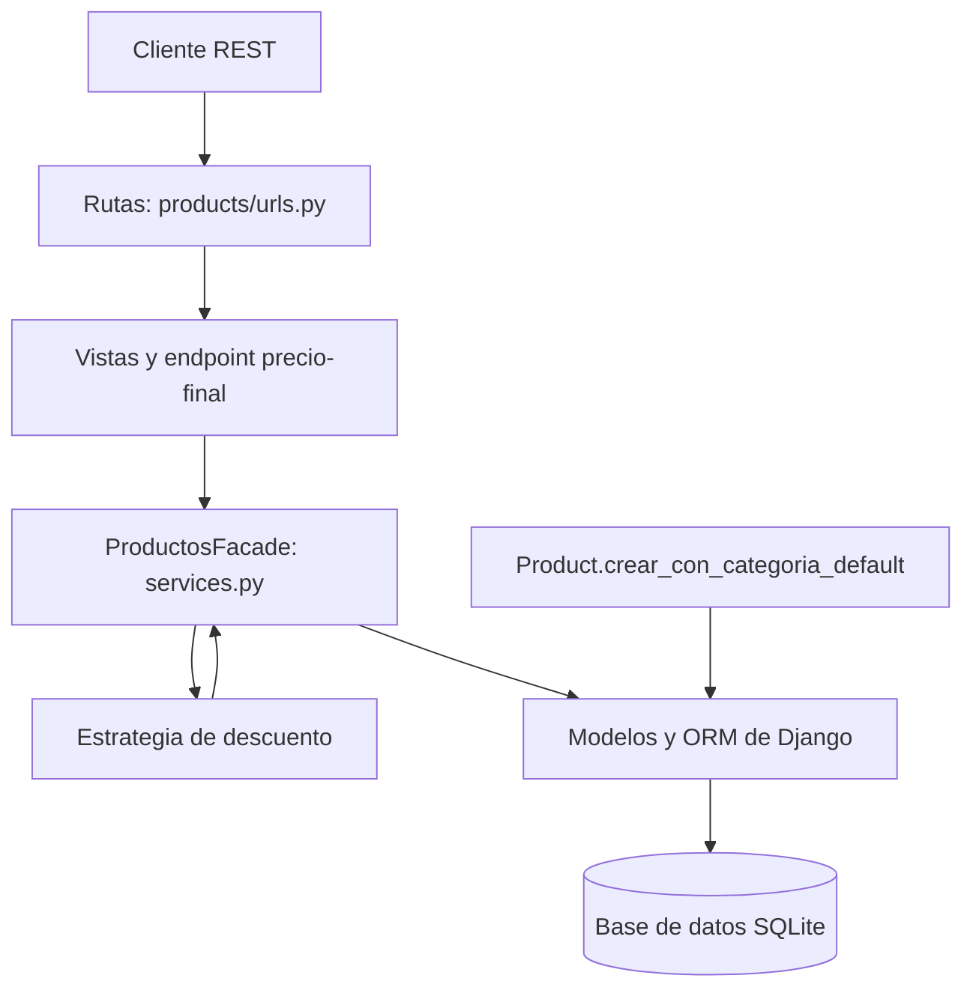

# Patrones de diseño en la API de productos

**Proyecto:** Tienda en línea con Django REST Framework  
**Práctica:** Capa de servicios y patrones de diseño

## Arquitectura en capas



La capa de presentación recibe las peticiones y las dirige a las vistas. La vista de precio final delega el cálculo en `ProductosFacade`, que consulta los productos y aplica una estrategia de descuento según la categoría. Los modelos representan los datos y el Factory Method centraliza la creación de productos con una categoría predeterminada.

## Patrones implementados

| Nombre | Categoría | Evidencia en el proyecto | Explicación |
|---|---|---|---|
| Factory Method | Creacional | `Product.crear_con_categoria_default` en `products/models.py` | Crea y guarda un producto, obteniendo o creando primero la categoría “General”. El código que solicita el producto no necesita construir directamente esa categoría. |
| Strategy | Comportamiento | `EstrategiaDescuento`, `DescuentoElectronica`, `DescuentoRopa` y `SinDescuento` en `products/services.py` | Encapsula distintas reglas intercambiables: electrónica recibe 10%, ropa 15% y las demás categorías no reciben descuento. |
| Facade | Estructural | `ProductosFacade.obtener_precios_finales` en `products/services.py` | Ofrece una operación sencilla que consulta los productos, selecciona la estrategia adecuada y prepara los precios para la API. |

## Endpoint de precio final

La ruta `GET /api/precio-final/` requiere autenticación JWT. Devuelve cada producto con categoría, precio original, porcentaje de descuento y precio final.

Ejemplo con dos productos de categorías distintas y precio original de 100.00:

```json
[
  {
    "name": "Audifonos",
    "category": "Electronica",
    "original_price": "100.00",
    "discount_percentage": 10,
    "final_price": "90.00"
  },
  {
    "name": "Camisa",
    "category": "Ropa",
    "original_price": "100.00",
    "discount_percentage": 15,
    "final_price": "85.00"
  }
]
```

**Captura del endpoint funcionando con dos categorías:**

_[Inserta aquí una captura real de la respuesta de `GET /api/precio-final/`. Asegúrate de que aparezcan productos de categorías distintas y sus precios finales. La petición debe incluir el token JWT. Si no tienes esos productos en la base de desarrollo, crea uno de categoría Electronica y otro de categoría Ropa antes de capturar. No uses el token en la captura. ]_

## Pruebas nuevas

- **`test_factory_creates_product_with_default_category`:** invoca el Factory Method y verifica que el producto guardado quede asociado a la categoría “General”.
- **`test_final_price_endpoint_uses_category_discount_strategy`:** solicita el endpoint autenticado con productos de electrónica y ropa, y comprueba que se apliquen los descuentos esperados: 10% y 15%.

**Captura de `products/tests.py` mostrando las dos pruebas nuevas:**

_[Inserta aquí una captura del archivo en VS Code. Puedes mostrar también las seis pruebas CRUD anteriores.]_

**Captura de `products/models.py` mostrando `crear_con_categoria_default`:**

_[Inserta aquí una captura del método Factory Method.]_

**Captura de `products/services.py` mostrando la estrategia de descuento:**

_[Inserta aquí una captura donde se vean las estrategias concretas y la selección por categoría.]_

## Resultado de ejecución

Comando ejecutado desde la carpeta del proyecto:

```powershell
.\venv\Scripts\python.exe manage.py test
```

Resultado: **8 pruebas ejecutadas, todas aprobadas (`OK`)**. Las seis pruebas CRUD y las dos pruebas nuevas pasan.

**Captura de la terminal con el resultado:**

_[Inserta aquí la captura de la terminal donde se vea `Found 8 test(s)`, los ocho puntos y `OK`.]_

## Preparación y entrega

1. Ejecuta el servidor con ` .\venv\Scripts\python.exe manage.py runserver` y prepara dos productos de categorías distintas para la captura del endpoint.
2. Obtén un token JWT con un usuario existente mediante `/api/token/` y envíalo como `Authorization: Bearer <token>` al consultar `/api/precio-final/`.
3. Sustituye cada marcador por su captura real.
4. Abre este documento en un editor compatible con Markdown o copia su contenido a Word, conserva el diagrama, inserta las capturas y exporta todo como **un solo PDF**.
